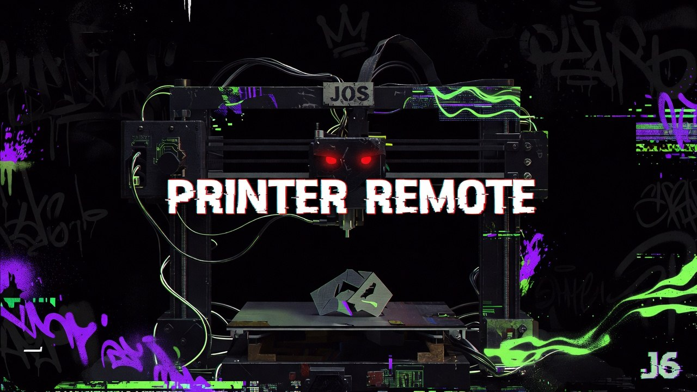

<p align="center"></p>

# 3D Printer Remote

> **Hardware status (honest):** on one real CR-10 SE (Creality OS, DWIN V1.1.0.28) these ran for real with the
> owner's OK: live data, `filament retract/unload/extrude`, `printer start`, and (2.0.0, during a running print)
> `printer pause`, `resume`, `fan`, `heat` (small mid-print change) and `light`. Not yet tried on hardware: upload,
> cancel, home, move, load, idle cooldown. Everything new in 2.0 (fleet, farm queue, autonomy policies, service,
> dashboard, tokens, alerts, Moonraker) is tested against fake printers only. `selftest hardware` walks the rest.
> See [docs/LIMITS.md](docs/LIMITS.md).

A bridge between your AI agent and **Creality Print 7.2** plus **Creality OS printers** (CR-10 SE first; K1 family by
protocol), and since 2.0 a small **farm control plane**: many printers, one shared queue, opt-in autonomy, a service
with a dashboard and REST API. Your AI agent (Grok Bot, Cursor, a custom agent...) runs one Python CLI and reads its
JSON. With no farm config it behaves exactly like 1.x: one printer, the owner's yes plus preflight for every action.

- **Slicer:** detect Creality Print; list, show, clone and edit presets (only copies, or user presets backed up
  first); slice 3MF/STL from the command line with overrides; read time, grams and cost from the gcode; open a file in
  the GUI; check bed fit and piece count; split a plate by color; recommend settings for the part.
- **Printer (LAN):** live data over the printer's websocket (`ws://<ip>:9999`): temps, state, progress, layers, times,
  fans, position and errors. It also lists files, history, mesh, timelapses and config, uploads gcode and checks the
  file landed, and runs read-only gcode queries (M105, M114...).
- **Jobs:** a print queue with filament-swap prompts, history and stats with cost, filament inventory, a maintenance
  tracker with a jam log, a file library, a gcode inspector, and a health report.
- **Camera (optional):** ET-timestamped snapshots, a bed-clear check, a first-layer photo, a done photo with a
  "clear the bed" reminder, timelapse build, and a malfunction watch with owner_inbox / Telegram alerts.
- **Filament:** extrude, retract, load and unload. Each one preheats for the material (`--material PLA` 210, PETG 240
  by default, ABS 245, ASA 250, TPU 225). `--purge` or `--temp 300` is the explicit 300 C hardened-filament purge.
  Then it moves the filament slowly and turns the nozzle off (or `--hold`). The hard cap is 300 C (the printer reports
  320 C; we stay under the stock hotend rating). Limits: 100 mm per extrude or retract, 120 mm per load or unload.
- **Owner approval:** start, pause, resume, cancel, heat, home, move, fan, cooldown, filament moves and motion/heat gcode never run on the first
  call. They create a request (`awaiting_owner`) with a summary. **The owner answers YES or NO in chat.** On yes the
  agent runs `approve <id> --yes`, an automatic **preflight** checks the printer, and the action runs only if preflight
  passes.

- **Farm (2.0, opt-in):** `printers.json` fleet with `--printer <name>` on every printer command, `fleet status` /
  `fleet stream` / read-only LAN `fleet discover`; a shared `farm` queue routed by material, color, nozzle, bed fit,
  availability and priority, with dependencies, N copies across the farm, batch affinity and failover; autonomy
  policies (`owner_yes` default, `auto_after_preflight` for trusted profiles, `notify_only`), a global and per-printer
  kill switch, rate limits and a full audit log; `serve` (supervised daemon, pid file, health endpoint, local
  dashboard, JSON REST API, hashed API tokens with owner / operator / viewer roles); webhook + Telegram alerts;
  per-printer machine-hour maintenance, spool locations, analytics, CSV/JSON order intake; pluggable slicers,
  failure detectors (ML hook) and recovery playbooks; a Moonraker backend stub; a reconnecting stream and a chaos
  test suite.

The core is the Python 3.12 standard library. Pillow and numpy are optional (camera features); PyYAML is optional
(`printers.yaml`).

## Quick start

Windows:
```
cd "3D Printer Remote"
python bots\printer_remote.py detect
python bots\printer_remote.py slice "C:\path\egg_set_plate.3mf" --walls 4 --infill 20 --brim 5
python bots\printer_remote.py printer status
python bots\printer_remote.py printer upload "...\plate_1.gcode" --name egg_set.gcode
python bots\printer_remote.py printer start egg_set.gcode --color white --material PETG   # -> awaiting_owner
#   agent shows the summary, owner says "yes"
python bots\printer_remote.py approve r20261126_141500_ab12 --yes --by owner_chat --quote "yes"
python bots\printer_remote.py filament retract --mm 10 --speed 2 --material PETG                        # -> awaiting_owner
python bots\printer_remote.py watch --interval 120 --stop-when-idle
```

Linux / macOS (set the slicer paths when they aren't the Windows defaults):
```
export CREALITY_PRINT_EXE="$HOME/Applications/CrealityPrint.AppImage"
export CREALITY_DATA_DIR="$HOME/.config/Creality/Creality Print/7.0"
export PRINTER_IP=<PRINTER_IP>   # your printer's LAN address
python3 bots/printer_remote.py detect
python3 bots/printer_remote.py printer status
```

Farm quick start (all optional; see [SETUP.md](SETUP.md#farm-mode-20-optional)):
```
python bots/printer_remote.py fleet discover --subnet 192.0.2.0/24          # read-only scan for port 9999
python bots/printer_remote.py fleet add se1 --material PETG --color white --ip-env PRINTER_IP_SE1
python bots/printer_remote.py fleet status
python bots/printer_remote.py farm add egg.gcode --material PETG --color white --copies 4
python bots/printer_remote.py farm plan                                       # dry run: who prints what
python bots/printer_remote.py farm dispatch                                   # uploads, then asks the owner per start
python bots/printer_remote.py serve                                           # http://127.0.0.1:8787 dashboard + API
python bots/printer_remote.py selftest hardware                               # what's still unproven on hardware
```

Setup: [SETUP.md](SETUP.md). Agent skill: [skills/printer-remote/SKILL.md](skills/printer-remote/SKILL.md).

## Commands

| command | what | needs owner yes |
|---|---|---|
| `detect` | exe, version, preset dirs, GUI open?, printer IP, camera | no |
| `presets list/show/clone/set` | presets; `set` only on user presets, backed up first | no |
| `slice` | Creality Print CLI slice, gcode + stats + inspector warnings | no |
| `open`, `split-check` | open in the GUI; bed fit, rotation, piece count | no |
| `recommend --part <kind>` | starting settings (kids-toy, car-exterior, car-interior, functional, decor, flat-sign, tall-thin) | no |
| `plates by-color` | split a plain 3MF into one plate per color | no |
| `gcode inspect` | time, grams, cost, temps vs material, pauses, out-of-bed moves | no |
| `queue add/list/skip/move/next` | print queue; `next` uploads and requests a start with the swap note | start does |
| `history list/stats/mark`, `filament ...`, `maint ...`, `library ...`, `timelapse build`, `health` | job tracking | no |
| `printer discover/probe/status/stream/latest/info` | read-only LAN + live data | no |
| `printer files/history/mesh/objects/timelapses/config/ota/materials` | read-only printer queries | no |
| `printer upload` | store gcode on the printer (does not print) | no |
| `printer gcode <line>` | M105/M114/M115/M119/M27/M31/M503/M20 free | anything else does |
| `printer start/pause/resume/cancel/heat/home/move/fan/cooldown`, `printer light` | physical actions | **yes** (light: no; `cooldown --urgent`: no) |
| `filament extrude --mm N` / `retract --mm N` / `load` / `unload` | preheat for the material (`--material PLA`; PETG 240 default; `--purge` = 300 C), wait within 3 C, move filament (M83, then M82), nozzle off | **yes** |
| `approve <id> --yes/--no`, `preflight <id>`, `pending` | owner answer, go/no-go checks, open requests | - |
| `camera snapshot/set-reference/bed-check` | camera | no |
| `watch [--once]` | malfunction watch, job events, alerts | pause asks the owner unless AUTO_PAUSE_ON_ANOMALY=true |
| `--printer <name>` (global, or on `printer`/`camera`/`watch` subcommands) | target one fleet printer from `printers.json` | - |
| `fleet list/status/stream/discover/add/set/remove` | multi-printer status, live stream, read-only LAN discovery, config | no |
| `farm add/list/plan/dispatch/sync/done/fail/cancel/release/priority/intake` | shared queue + routing; `dispatch` asks per start (policy) | start does (unless policy says auto) |
| `policy show/check/set/kill/unkill`, `audit` | autonomy levels, kill switch, rate limits, audit log | set/unkill: owner role |
| `token create/list/revoke` | API tokens (hashed) with roles owner / operator / viewer | owner role |
| `alerts test/list` | webhook + Telegram alerts | no |
| `serve [--host --port --interval --watch --auto-dispatch] / --status / --stop` | daemon + dashboard + REST API | API approvals need an owner token |
| `ops maint/spool/analytics` | machine-hour maintenance per printer, spool locations, analytics | no |
| `slicer list/slice --backend creality|orca|prusa` | pluggable slicers (orca/prusa are stubs) | no |
| `detector list/run`, `playbook list/run` | failure detectors (imagediff + ML hook), recovery playbooks | playbook pause/cancel ask per policy |
| `selftest hardware [--run step / --record step]` | walk the unverified actions one gated step at a time | gated steps do (never auto) |

## Approval and preflight

1. A physical command returns `status: awaiting_owner`, a `request_id` and a `summary` (part, time, filament,
   snapshot if a camera is set). An owner_inbox packet `printer_remote - approve <action>_<ts>.json` is written.
2. The agent shows the summary and asks the owner. **Only the owner's own yes or no counts.** The agent passes it on
   with `approve <id> --yes` or `--no` (`--by` names the source, `--quote` keeps the owner's words). It's recorded with
   an ET timestamp.
3. On yes, `preflight` runs: kill switch on, printer online, idle (or printing/paused, as the action needs), no
   printer error, temps sane, the file is on the printer (start), filament on hand (when inventory is used), and the
   camera bed check (flags it; blocks only on a clearly bad score). The action runs only if nothing blocking fails;
   otherwise the status is `preflight_failed` and the failed checks are listed.
4. **Urgent cooldown** is the one exception: `printer cooldown --urgent --reason "..."` turns the heaters off right away
   with no owner yes, for urgent cases only (jam, burning smell, runaway heat or printer error, crash on camera, owner
   says stop, a hot nozzle left after a failure). It's logged to owner_inbox and the safety log. Nothing else can be
   urgent.
5. Requests expire after `APPROVAL_TTL_MIN` (15 by default) and are single use; asking twice for the same thing
   returns the open request (idempotent). `PHYSICAL_ACTIONS_ENABLED=false` and the kill switch (`policy kill`) block
   everything, including auto-pause; urgent cooldown still works.
6. **Autonomy is opt-in (2.0).** Without a `policy.json` nothing changes. With one, a printer, group or trusted
   profile can be `auto_after_preflight` (only for start / pause / resume / cooldown, and only those listed in
   `auto_actions`; rate limited; audited) or `notify_only` (never sends; writes a notice). Heat, move, home, fan,
   gcode, filament moves, cancel and hardware self-test steps always need the owner.

## Output contract

Every command prints one JSON object: `status` (`ok`, `error`, `skipped`, `awaiting_owner`, `declined`,
`preflight_failed`, `alert`, `notified`), `job_id`, `command`, `errors`, `warnings`, `started_at` / `finished_at` (ET) plus its
data. `printer stream --jsonl` prints one JSON line per update, then a `summary` line. Exit code 1 on `error`.

Owner packets: `owner_inbox/printer_remote - <subject>_<YYYYMMDD_HHMMSS>.json`, written as `.tmp` then renamed, with
`id, type, received_at (ET), lane, priority, context{summary, output, status}`.

## Tests

```
python -m unittest discover -s bots/tests -v
```

Standard library only, offline (fake slicer, multiple fake printers with chaos controls, fake camera, Telegram,
webhook, Moonraker and ML servers), no hardware needed. 139 tests. Optional: `pip install -r requirements-dev.txt` adds pytest, and then `python -m pytest bots/tests` works too.

## Honest limits

See [docs/LIMITS.md](docs/LIMITS.md). In short: some physical actions are verified on one real CR-10 SE and others are
not; every farm feature is fake-tested only and no multi-printer farm has run it yet; the camera checks are simple
image diffs that lighting can fool; the Creality Print CLI crashes on some 7.x builds (issue #574). For a revenue farm
today, a mature platform is lower risk; this project's value is the agent + owner-approval design.

## Credits

Built for The Right Mods by Bentayga Empire LLC. Ideas from
[marcmayol/claude-code-creality-print-plugin](https://github.com/marcmayol/claude-code-creality-print-plugin) and
[sairaph/creality-slicer-mcp](https://github.com/sairaph/creality-slicer-mcp) (both MIT). No code was copied; see
[docs/CREDITS.md](docs/CREDITS.md).

MIT license.
